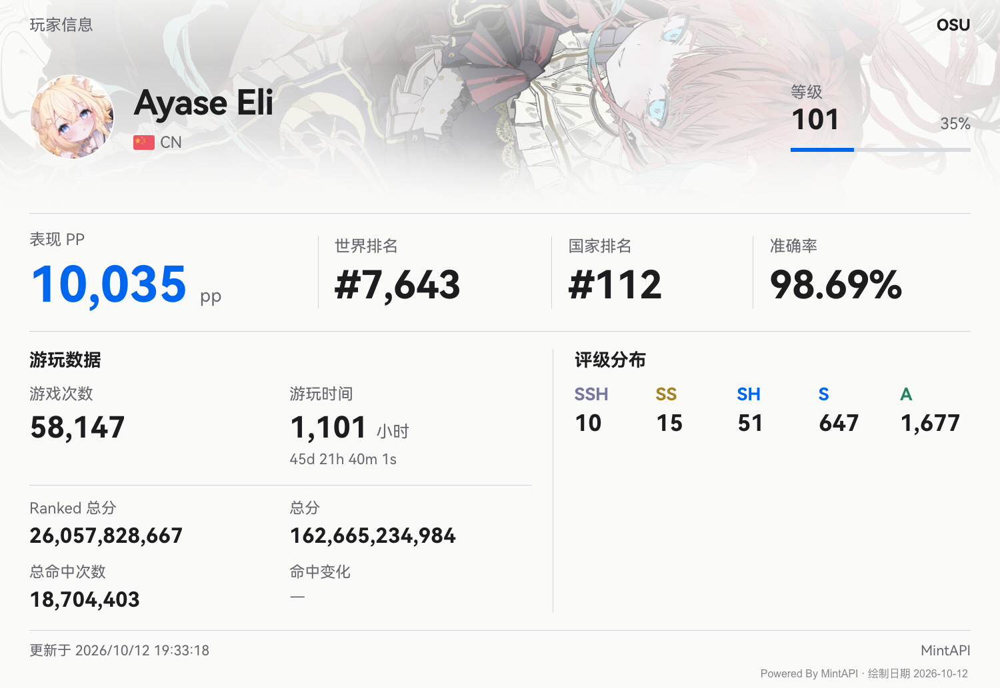
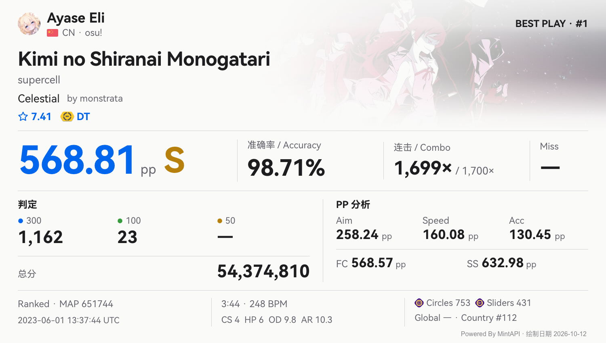
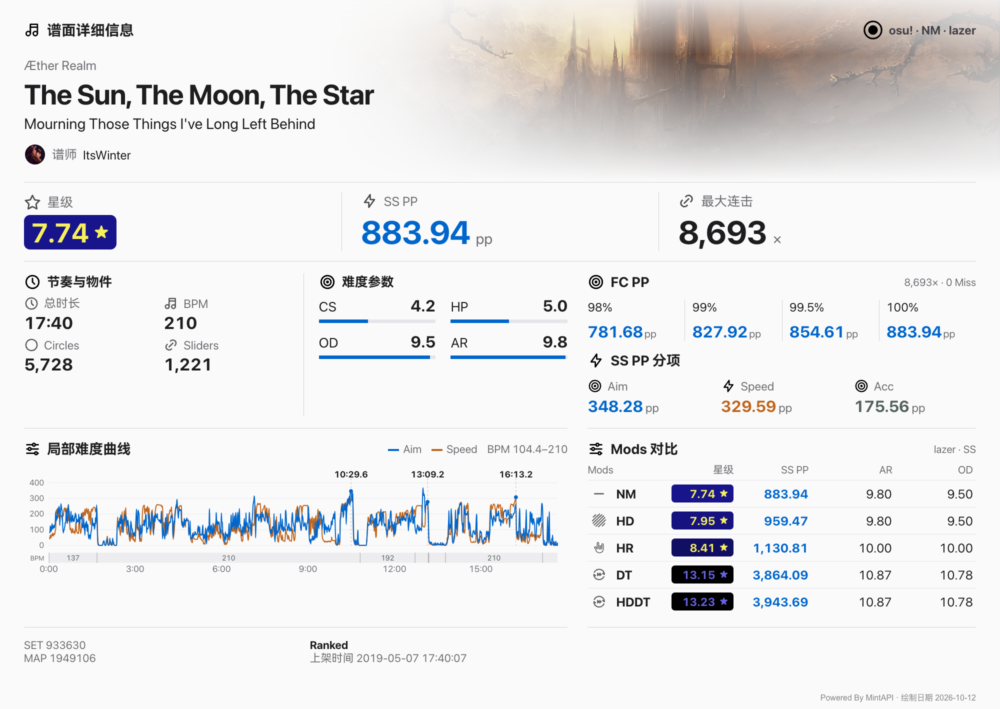

<div align="center">

<!-- Logo 预留位置：准备好后，将下方注释替换为图片。 -->
<!--  -->
<br />

# MintAPI

面向 osu! 的数据查询、分析与图片渲染 API


[](LICENSE)


[功能](#功能) · [效果预览](#效果预览) · [快速开始](#快速开始) · [API 与文档](#api-与文档) · [开发](#开发)

</div>

## 简介

MintAPI 由 [**HitCircleAPI**](https://github.com/Tsurumaki-Kokoro/HitCircle-API) 迁移改造而来，在原有 osu! 数据查询与图片渲染能力的基础上，持续完善接口、渲染和服务架构。可作为机器人或其他应用的后端，提供玩家、成绩、谱面与多人比赛相关的数据和可视化输出。

## 功能

| 类别 | 能力 |
| --- | --- |
| 玩家 | 信息图、头像卡、平台账号绑定、自定义背景、排行榜 |
| 成绩 | Recent、Best Play、BP 列表、新增 BP、指定谱面成绩、PP 分析与修复预测 |
| 历史 | 玩家数据变化、已采集成绩记录与趋势图 |
| 谱面 | 谱面与谱面集信息图、搜索、BPM 明细、难度曲线与 Mods 对比 |
| 预览 | 四模式谱面 PNG / GIF 预览、带音频 MP4、原生 GIF 高难度片段选择 |
| 比赛 | 多人房历史、评分、实时订阅与单局结果图 |

按接口提供 JSON、PNG、GIF 或 MP4；图片接口支持的主题见对应文档。

## 效果预览

### 玩家信息



### 最佳成绩



### 谱面信息



## 快速开始

### 1. 准备环境

- .NET 9 SDK、Rust 工具链。
- 可连接的 MySQL 与 Redis，以及 osu! OAuth 应用的 Client ID / Client Secret。
- Playwright Chromium，用于 HTML 图片渲染。
- 使用谱面预览或发布服务时，按[谱面预览文档](docs/beatmap-preview.md#安装与发布)安装预览引擎。

### 2. 获取源码

两个仓库需要放在同一父目录，MintAPI 通过项目引用使用 MintOsuApi。

```sh
git clone https://github.com/Tsurumaki-Kokoro/MintAPI.git
git clone https://github.com/Tsurumaki-Kokoro/mint-osuapi.git
cd MintAPI
```

### 3. 配置服务

```sh
cp MintAPI/appsettings.Development.json.example MintAPI/appsettings.Development.json
```

填写 `ApiKey`、`OsuApi` 和 `ConnectionStrings`。创建连接串指定的空数据库，服务启动时会自动应用 EF Core 迁移；具体步骤见[数据库迁移](docs/database-migrations.md)。

### 4. 构建并启动

```sh
dotnet build MintAPI.sln
pwsh MintAPI/bin/Debug/net9.0/playwright.ps1 install chromium
dotnet run --project MintAPI --launch-profile http
```

Chromium 安装命令需要 PowerShell；Linux 系统依赖安装见 [Playwright 文档](https://playwright.dev/dotnet/docs/browsers#install-system-dependencies)。

服务地址：`http://localhost:5251`，交互式文档：[Scalar](http://localhost:5251/scalar/v1)。

### 5. 调用接口

业务接口通过 `access_token` 请求头传入配置中的 `ApiKey`。例如，生成谱面信息图：

```sh
curl --fail 'http://localhost:5251/beatmap/beatmap?beatmap_id=1949106' \
  -H 'access_token: YOUR_API_KEY' \
  -H 'Accept: image/png' \
  -o beatmap.png
```

## API 与文档

开发环境提供 [Scalar](http://localhost:5251/scalar/v1) 和 [OpenAPI JSON](http://localhost:5251/openapi/v1.json)，用于查看完整参数和响应类型。

| 主题 | 文档 |
| --- | --- |
| 玩家 | [头像卡](docs/avatar-card.md) · [排行榜](docs/user-ranking.md) |
| 成绩与历史 | [成绩主题](docs/score-themes.md) · [历史记录](docs/history.md) |
| 谱面 | [信息图](docs/beatmap-info.md) · [搜索](docs/beatmap-search.md) · [预览与视频](docs/beatmap-preview.md) |
| 多人比赛 | [历史与评分](docs/multiplayer.md) · [实时订阅](docs/matchlive.md) |
| 运维与接入 | [配置](docs/configuration.md) · [数据库迁移](docs/database-migrations.md) · [错误码](docs/api-errors.md) |
| API 客户端 | [MintOsuApi 开发](docs/mint-osuapi-development.md) |

控制器业务错误使用 `application/problem+json`，包含 `status`、`code`、`message` 和 `traceId`；图片接口的错误也按此格式返回。接入方应根据状态码及 `code` 判断结果。

## 开发

```text
MintAPI/                 ASP.NET Core 服务
  Controllers/           HTTP 接口
  Services/              数据访问、计算与渲染服务
  Data/                  EF Core 模型与迁移
  Rendering/             图片主题与 HTML 模板
  wwwroot/               字体、图标与图片资源
native/rosu-pp-ffi/       Rust PP 计算库与 C# 绑定
tests/MintAPI.Tests/     测试
docs/                    功能与运维文档
../mint-osuapi/           osu! API 客户端及其测试
```

```sh
dotnet build MintAPI.sln
dotnet test MintAPI.sln
```

构建会自动编译 rosu-pp 原生库。渲染集成测试需要 Chromium。

欢迎通过 [Issues](https://github.com/Tsurumaki-Kokoro/MintAPI/issues) 反馈问题，或提交 Pull Request。接口变更请同步文档与测试；图片变更请附实际渲染结果。

## 致谢与许可证

- [HitCircleAPI](https://github.com/Tsurumaki-Kokoro/HitCircle-API)：项目迁移改造的起点。
- [osu!](https://osu.ppy.sh/) 与 [MintOsuApi](https://github.com/Tsurumaki-Kokoro/mint-osuapi)：游戏数据与 API 客户端。
- [rosu-pp](https://github.com/MaxOhn/rosu-pp)、[Playwright](https://github.com/microsoft/playwright) 与 [Scriban](https://github.com/scriban/scriban)：性能计算、浏览器渲染与模板支持。

本项目采用 [AGPL-3.0 许可证](LICENSE)。依赖、字体及图片等资源遵循各自的许可证与使用条款。
